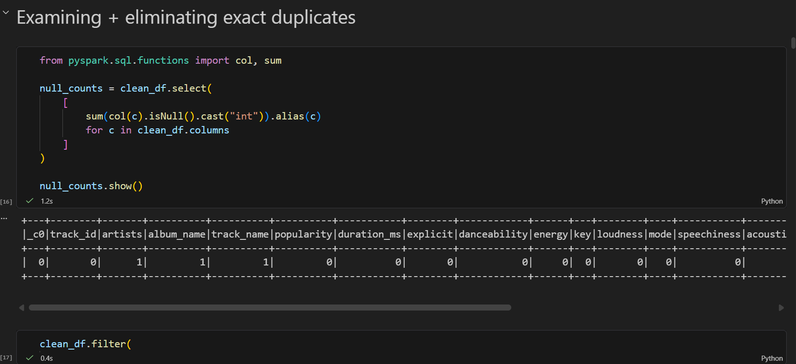
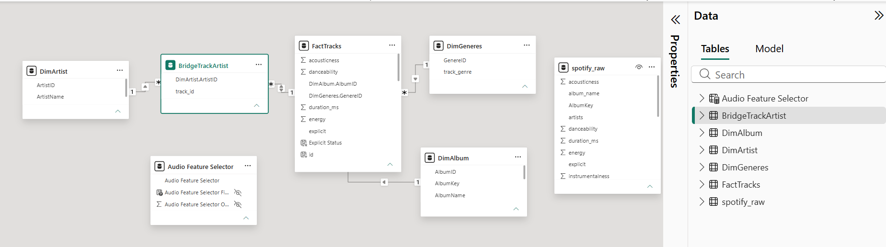
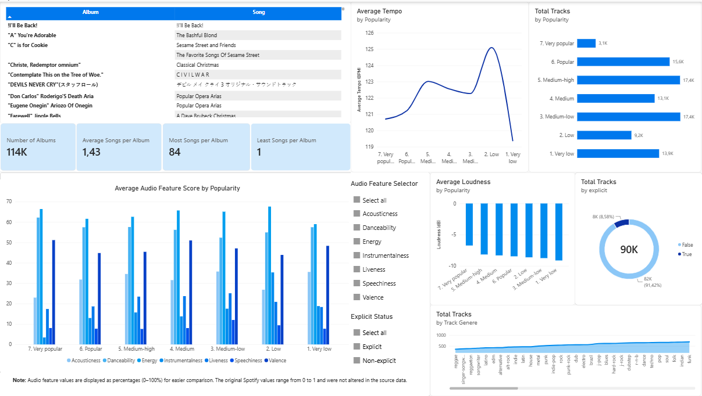
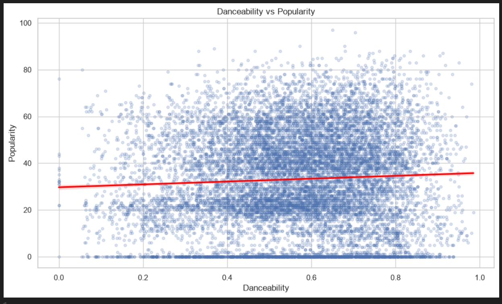
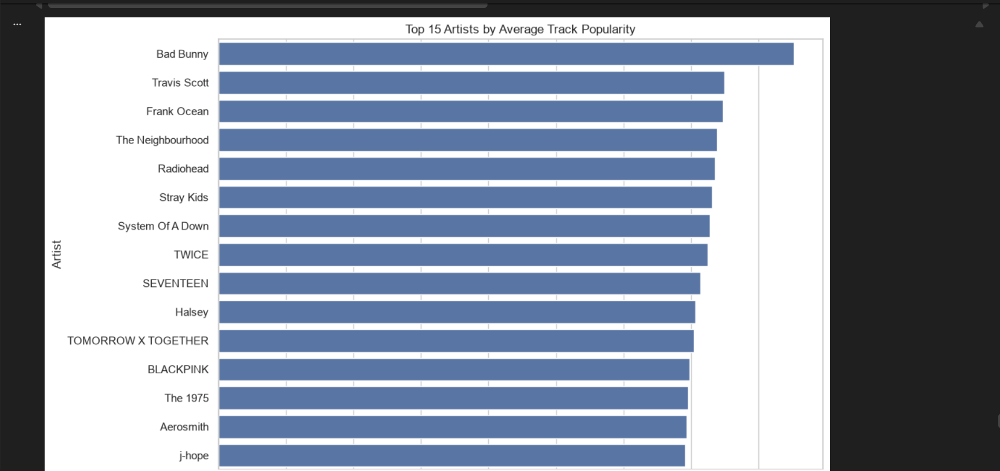

# spotify-analytics-hit-prediction

This project consists in 4 main sections:
1. Dataset Exploration and Preparation
2. PowerBI Interactive Dashboard
3. Python Analytics
4. ML Hit prediction

## 1. Dataset exploration and preparation
Part 1 focuses on exploring, cleaning and preparing a Spotify tracks dataset for further analysis, PowerBI dashboard and Machine Learning using PySpark.

#### Main sections
- Data Exploration: Examines the dataset structure, track popularity, genres and audio features.
- Data Cleaning: Handles missing values, removes exact duplicates and checks for invalid or inconsistent data.
- Exploratory Data Analysis (EDA): Analyzes popularity distributions and compares track popularity across genres.
- Machine Learning Preparation: Aggregates records to obtain one observation per track and creates a binary hit target variable based on popularity.
- Data Export: Saves three processed datasets for further use: clean, analytics and ml.

#### Tools
Python – Main programming language.
Jupyter Notebook - Coding interface
PySpark / Apache Spark – Data processing and manipulation.
Pandas – Data conversion and CSV export.
EDA – Exploratory Data Analysis.
Data Cleaning & Validation – Improving data quality.
Machine Learning Data Preparation – Preparing the dataset for future modelling.

## 2. PowerBI Interactive Dashboard
Part 2 of the project focuses on building an interactive Power BI dashboard using the processed `spotify_tracks_analytics.csv` dataset.

The dataset is transformed into a relational data model, dividing the original data into multiple tables to organize track, artist, album and genre information.

The main goal is to transform the processed Spotify dataset into an interactive dashboard that makes it easier to explore music trends, compare audio characteristics and understand patterns in track popularity.

#### Main sections
- Data Modelling: Splitting the original dataset into separate tables (`FactTracks`, `DimArtist`, `DimAlbum`, `DimGenres` and others) to create a structured data model.
- Relationships: Using bridge tables such as `BridgeTrackArtist` to manage relationships between tracks and artists.
- Interactive Dashboard: Visualizations and interactive filters to explore Spotify trends, track popularity and audio features.
- Audio Feature Analysis: Addition of interactive elements that allow users to explore characteristics such as danceability, energy, valence and tempo along the whole dashboard not just individually by graph.

## 3. Python Analytics
Part 3 consists in analyzing the Spotify dataset to identify patterns and relationships between track popularity, music genres, artists and audio features.

Using PySpark for data processing and Python visualization libraries.

It is based on these 10 questions:
    Q1:	Which genres have the highest average popularity?
    Q2:	Which genres are the most danceable?
    Q3:	Which genres are the most energetic?
    Q4:	Does danceability correlate with popularity?
    Q5:	Does energy correlate with popularity?
    Q6:	What characteristics are associated with highly popular tracks?
    Q7:	How do popular and less-popular songs differ?
    Q8:	Are explicit songs different from non-explicit songs?
    Q9:	Which artists are the most popular?
    Q10: Which tracks are the most popular?

#### Tools
Python – Main programming language.
Jupyter Notebook - Coding interface
PySpark / Apache Spark – Data processing, aggregation and analysis.
Pandas – Data conversion and manipulation.
Matplotlib & Seaborn – Data visualization.
Exploratory Data Analysis (EDA) – Investigating patterns and trends.
Statistical Correlation – Measuring relationships between variables.
Data Aggregation & Grouping – Analyzing tracks, genres and artists.
Data Visualization – Presenting analytical findings through charts.

## 4. ML Hit prediction
This final part of the project focuses on building and evaluating Machine Learning models to predict whether a Spotify track belongs to the top 20% of tracks by popularity, using its audio characteristics and explicit-content metadata.

Using PySpark and Spark MLlib, three different classification algorithms are trained and compared to identify the best-performing model.

#### Main sections
- Data Preparation: Loads the prepared ML dataset created in part 1, checks data quality and aggregates records to ensure one row per track.
- Target Creation: Defines a binary hit variable based on the 80th percentile of popularity in the training set.
- Train-Test Split: Divides the data into training (80%) and testing (20%) sets.
- Data Preprocessing: Prepares the input variables (features) before training:
    - Imputation: Fills missing numerical values using the median, preventing missing data from interfering with model training.
    - Feature Vector Assembly: Combines the different audio characteristics and explicit-content information into a single feature vector that Spark MLlib models can process.
    - Feature Scaling: Standardizes the features by adjusting their scale, helping algorithms such as Logistic Regression work more effectively. Scaling is applied to Logistic Regression in this project, while Random Forest and Gradient-Boosted Trees use the unscaled feature vector.
- Model Training: Trains and compares three classification algorithms:
    - Logistic Regression: Estimates the probability that a track is a hit based on its features. 
    - Random Forest: Combines multiple decision trees and aggregates their predictions. This helps capture more complex relationships between audio features and popularity.
    - Gradient-Boosted Trees: Builds decision trees sequentially, with each new tree attempting to correct errors made by previous ones. This can capture complex patterns in the data.
- Model Evaluation: Measures and compares model performance using several metrics:
    - Accuracy: The percentage of all predictions that are correct.
    - Precision: Of all tracks predicted as hits, the proportion that are actually hits. High precision means fewer false positives.
    - Recall: Of all actual hits, the proportion correctly identified by the model. High recall means fewer missed hits.
    - F1-score: The harmonic mean of precision and recall, balancing both metrics.
    - ROC-AUC: Measures how well the model distinguishes between hits and non-hits across different classification thresholds.
    - PR-AUC: Measures the trade-off between precision and recall across different thresholds. It is particularly useful when the classes are imbalanced, as in this project, where hits represent approximately 20% of the tracks.
- Error Analysis: Uses confusion matrices to identify true positives, true negatives, false positives and false negatives. It also examines individual misclassified tracks to understand where and why the models make incorrect predictions.
- Model Selection: Selected the best-performing model based on PR-AUC. Since the dataset is imbalanced, accuracy alone can be misleading: a model could achieve high accuracy simply by predicting that most tracks are non-hits. PR-AUC focuses on how effectively the model identifies the minority class (hits), balancing precision and recall. Therefore, it is a more relevant primary selection metric for this classification task.